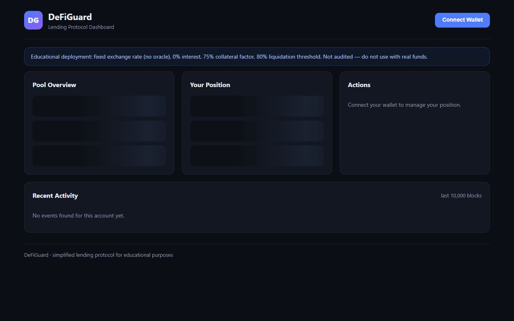
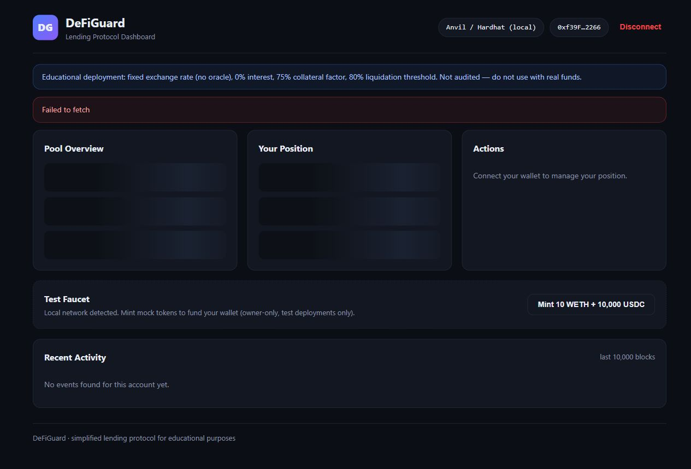
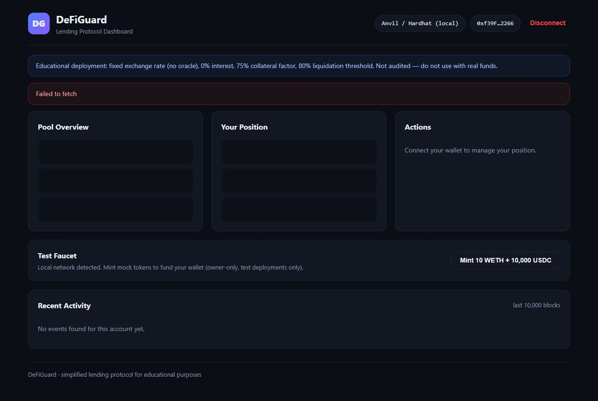
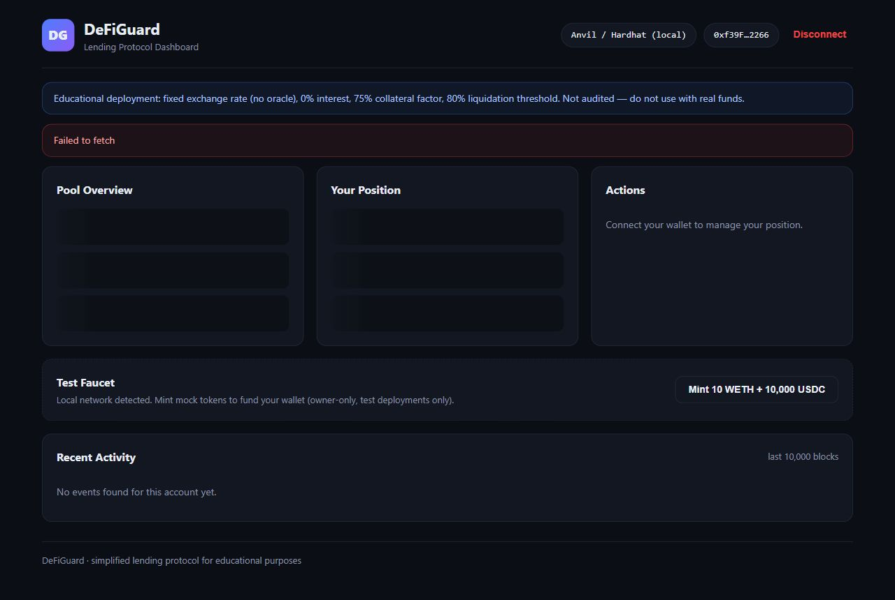
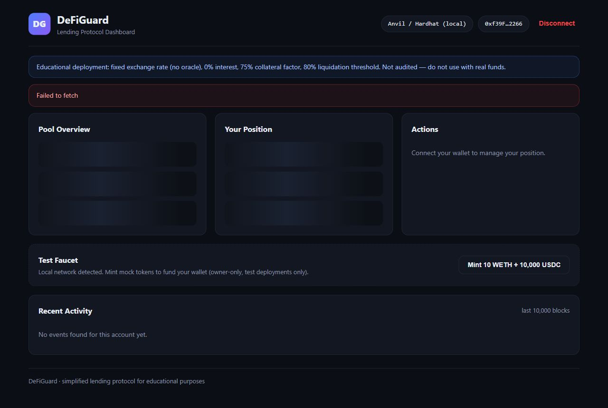
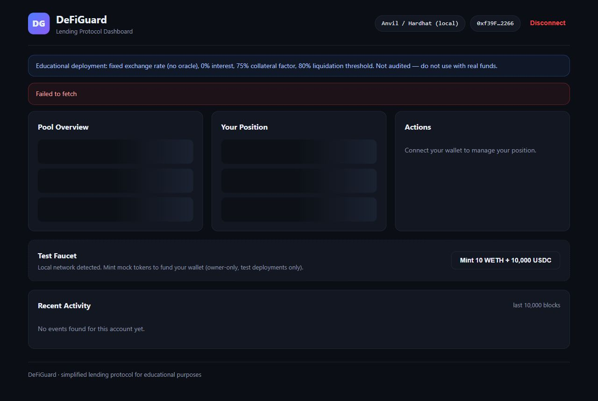
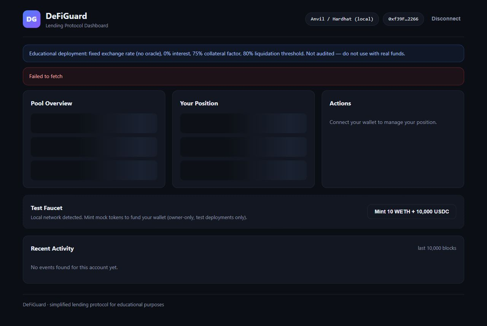

# DeFiGuard

A simplified single-collateral / single-borrow DeFi lending protocol built with
Solidity 0.8.24, Foundry, OpenZeppelin, and a React + Vite dashboard.

> **Educational / local-testing only.** The protocol uses a fixed, owner-settable
> exchange rate (no price oracle), 0% interest, and has **not been audited**.
> Never use with real funds.

---

## Table of Contents

- [Architecture](#architecture)
  - [Dependencies](#dependencies)
  - [Theme & Design System](#theme--design-system)
- [Risk Parameters & Invariants](#risk-parameters--invariants)
- [Smart-Contract API](#smart-contract-api)
- [Frontend](#frontend)
- [Quick Start (End-to-End on a Local Node)](#quick-start-end-to-end-on-a-local-node)
- [Smart-Contract Usage](#smart-contract-usage)
- [Testing](#testing)
- [Frontend Usage](#frontend-usage)
- [Configuration Reference](#configuration-reference)
- [Screenshots](#screenshots)
- [Disclaimer](#disclaimer)

---

## Architecture

| Component | Path | Description |
| --- | --- | --- |
| `LendingPool.sol` | `src/` | Core lending pool. Deposit collateral, borrow against it (75% max LTV), repay, withdraw while healthy (80% liquidation threshold). Fixed exchange rate (testing only), 0% interest. Ownable + reentrancy-guarded. |
| `MockERC20.sol` | `src/` | Mintable/burnable ERC-20 with configurable decimals and EIP-2612 `permit` support. Test-only. |
| `Deploy.s.sol` | `script/` | Deployment script: deploys WETH mock (18 dp), USDC mock (6 dp), and the pool; mints test tokens to the deployer; approves the pool to spend them. |
| `LendingPool.t.sol` | `test/` | Foundry unit tests (deposit, withdraw, borrow, repay, borrow-limit, zero-amount, pause). |
| **Frontend** | `frontend/` | React 18 + Vite + ethers.js v6 dashboard. |

### Dependencies

| Package | Version | Purpose |
| --- | --- | --- |
| Solidity | `0.8.24` | Compiler (with optimizer + via-IR) |
| OpenZeppelin Contracts | v5 | ERC-20, ERC20Permit, SafeERC20, ReentrancyGuard, Ownable |
| Foundry (Forge/Anvil/Cast) | 1.8.5 | Build, test, deploy |
| React | 18 | UI framework |
| ethers.js | v6 | Blockchain interaction |
| Vite | 5 | Bundler / dev server |

### Theme & Design System

The frontend uses a custom dark theme defined in `frontend/src/styles.css`, built on
CSS custom properties (`:root`). The palette is DeFi-oriented: deep navy backgrounds
with blue accent, green/yellow/orange/red status indicators.

| Token | CSS Variable | Value | Purpose |
| --- | --- | --- | --- |
| Background | `--bg` | `#0b0e14` | Page background |
| Card | `--bg-card` | `#131722` | Card / surface background |
| Input | `--bg-input` | `#0d1117` | Input fields |
| Border | `--border` | `#232a3a` | Card/input borders |
| Text | `--text` | `#e8ecf4` | Primary text |
| Text muted | `--text-muted` | `#8b94a7` | Secondary text |
| Accent | `--accent` | `#4f7cff` | Blue primary actions |
| Accent hover | `--accent-hover` | `#3d68e0` | Hover state |
| Green | `--green` | `#22c55e` | Success / healthy / deposit |
| Yellow | `--yellow` | `#eab308` | Warning / watch out |
| Orange | `--orange` | `#f97316` | Danger / at-risk / withdraw |
| Red | `--red` | `#ef4444` | Liquidated / error / paused |
| Radius | `--radius` | `14px` | Border radius |

**Health factor gauge status colors:**
- `≥ 2.0` → **safe** (green)
- `≥ 1.2` → **warning** (yellow)
- `≥ 1.0` → **danger** (orange)
- `< 1.0` → **liquidated** (red)
- No debt → **nodebt** (green, ∞)

**Event log color coding:**
- Deposit → green, Withdraw → orange, Borrow → blue, Repay → purple, Pool events → muted

---

## Risk Parameters & Invariants

| Parameter | Value | Description |
| --- | --- | --- |
| Collateral Factor (max LTV) | **75%** | `COLLATERAL_FACTOR = 0.75e18`. Max borrowable = `collateralValue * 0.75`. |
| Liquidation Threshold | **80%** | `LIQUIDATION_THRESHOLD = 0.80e18`. Position must keep `collateralValue * 0.80 > debt`. |
| Exchange Rate | **2000** (default) | 1 collateral token (WETH) = 2000 borrow tokens (USDC) value. Owner-settable via `setExchangeRate`. |
| Interest Rate | **0%** | Principal-only debt; no accrual. MVP simplification. |
| Liquidation Threshold (HF) | **1.0** | Health factor = `(collateralValue * 0.80) / debt`. HF < 1 = undercollateralized. |

**Key invariant:** Because `COLLATERAL_FACTOR (75%)` < `LIQUIDATION_THRESHOLD (80%)`, any
undercollateralized position automatically has zero `availableBorrow`, so `borrow()` can never
push a position past the safety limit. A withdrawal that would break health reverts with
`PositionUndercollateralized()`.

---

## Smart-Contract API

### LendingPool

**Constructor**

```solidity
constructor(address _collateralToken, address _borrowToken)
```

Reverts on zero addresses or identical token addresses (`ZeroAddress`, `SameTokenAddress`).

**View functions**

| Function | Returns | Description |
| --- | --- | --- |
| `collateralToken()` | `IERC20` | Collateral token (e.g. WETH). |
| `borrowToken()` | `IERC20` | Borrow token (e.g. USDC). |
| `exchangeRate()` | `uint256` | Borrow units per collateral unit (scaled by 1e18). |
| `COLLATERAL_FACTOR()` | `uint256` | Constant: `0.75e18`. |
| `LIQUIDATION_THRESHOLD()` | `uint256` | Constant: `0.80e18`. |
| `PRECISION()` | `uint256` | Constant: `1e18`. |
| `collateralBalance(address user)` | `uint256` | User's deposited collateral. |
| `debtBalance(address user)` | `uint256` | User's outstanding debt. |
| `totalCollateral()` | `uint256` | Total collateral held by the pool. |
| `totalDebt()` | `uint256` | Total outstanding debt across all users. |
| `paused()` | `bool` | Emergency pause state. |
| `getCollateralValue(address user)` | `uint256` | Collateral value in borrow-token units. |
| `getMaxBorrow(address user)` | `uint256` | Max debt = `collateralValue * 0.75`. |
| `getDebt(address user)` | `uint256` | Alias for `debtBalance`. |
| `getHealthFactor(address user)` | `uint256` | `collateralValue * 0.80 / debt` (scaled 1e18). Returns `type(uint256).max` if no debt. |
| `isPositionHealthy(address user)` | `bool` | Exact health check (no intermediate division loss). |
| `getAvailableBorrow(address user)` | `uint256` | `maxBorrow - currentDebt`. |
| `getPosition(address user)` | tuple | Batched read: `(collateral, debt, collateralValue, maxBorrow, availableBorrow, healthFactor, healthy)`. |

**Core functions**

| Function | Description |
| --- | --- |
| `deposit(uint256 amount)` | Deposit collateral. Caller must `approve` first. |
| `withdraw(uint256 amount)` | Withdraw collateral (reverts if undercollateralized). |
| `borrow(uint256 amount)` | Borrow tokens (reverts if exceeds borrow limit). |
| `repay(uint256 amount)` | Repay part of your debt. |
| `repayAll()` | Repay your entire debt in one call. |

**Admin functions (owner-gated)**

| Function | Description |
| --- | --- |
| `setPaused(bool _paused)` | Pause / unpause all user-facing functions. |
| `setExchangeRate(uint256 newRate)` | Update the exchange rate (testing only — use a price oracle in production). |
| `emergencyWithdraw(IERC20 token, address to, uint256 amount)` | Withdraw arbitrary ERC-20 from the pool. **Centralization risk**: owner can drain user collateral. |

**Custom errors**

| Error | Trigger |
| --- | --- |
| `ZeroAddress()` | Constructor, `emergencyWithdraw` with zero address. |
| `ZeroAmount()` | Any function called with `amount == 0`. |
| `SameTokenAddress()` | Constructor with identical collateral and borrow tokens. |
| `ZeroExchangeRate()` | `setExchangeRate(0)`. |
| `InsufficientCollateral()` | `withdraw` amount > deposited collateral. |
| `InsufficientBalance()` | `repay` amount > outstanding debt. |
| `ExceedsBorrowLimit()` | `borrow` exceeds available borrow capacity. |
| `PositionUndercollateralized()` | `withdraw` would leave position below liquidation threshold. |
| `PoolPausedError()` | Any user action while `paused == true`. |
| `NoDebtToRepay()` | `repayAll()` with zero debt. |
| `InvalidOperation()` | Receiving plain ETH via `receive()`. |

**Security measures**
- OpenZeppelin `ReentrancyGuard` (nonReentrant on all state-changing functions).
- OpenZeppelin `SafeERC20` for all token transfers.
- Checks-Effects-Interactions pattern on every function.
- Solidity 0.8.x checked arithmetic (no `unchecked`).
- Custom errors on every revert path.

### MockERC20

```solidity
constructor(string name, string symbol, uint8 decimals)
```

| Function | Access | Description |
| --- | --- | --- |
| `mint(address to, uint256 amount)` | Owner | Mint new tokens. |
| `burn(address from, uint256 amount)` | Owner | Burn tokens. |
| `decimals()` | Public | Returns the configured decimal count (override). |

Inherits `ERC20`, `ERC20Permit` (EIP-2612), and `Ownable`.

---

## Frontend

A Web3 dashboard in `frontend/` (React 18 + Vite + ethers.js v6).

### Features

- Wallet connect/disconnect (MetaMask or any injected EIP-1193 wallet)
- Pool overview: total collateral, total debt, exchange rate, collateral factor, liquidation threshold, pause state
- Position dashboard: deposited collateral, collateral value, debt, max borrow, available borrow, and a color-coded **health factor gauge** (0–3x, with liquidation marker at 1.0)
- Actions with guided ERC-20 approvals: **Deposit**, **Withdraw**, **Borrow**, **Repay** (partial + repay-all)
- Pre-flight checks that mirror the on-chain logic (insufficient balance, borrow-limit, and withdrawal-would-break-health warnings)
- Custom-error decoding for every revert path (e.g. `ExceedsBorrowLimit`, `PositionUndercollateralized`, `PoolPausedError`)
- Recent activity feed: Deposited / Withdrawn / Borrowed / Repaid / pool events (last 10,000 blocks)
- Test faucet (local networks only): mints 10 collateral + 10,000 borrow tokens
- Wrong-network and paused-pool banners; auto-refresh every 15 s

### Project structure

```
frontend/
├── .env                  # Environment (create from .env.example)
├── .env.example
├── package.json
├── vite.config.js        # port 5173, host: true
├── index.html
└── src/
    ├── main.jsx          # React entry point
    ├── App.jsx           # Root component
    ├── config.js         # Contract addresses, chain ID, refresh interval
    ├── abis.js           # LendingPool & ERC20 ABIs (incl. custom errors)
    ├── utils.js          # Formatting, parsing, error decoding, health logic
    ├── styles.css        # Dark-themed design system (~740 lines)
    ├── hooks/
    │   └── useDeFiGuard.js   # Wallet, reads, TX orchestration, events
    └── components/
        ├── WalletConnect.jsx
        ├── PoolStats.jsx
        ├── PositionCard.jsx
        ├── HealthGauge.jsx
        ├── ActionPanel.jsx
        ├── EventLog.jsx
        └── TestFaucet.jsx
```

---

## Quick Start (End-to-End on a Local Node)

```shell
# terminal 1 — start the local chain
anvil

# terminal 2 — deploy contracts
forge script script/Deploy.s.sol \
  --rpc-url http://127.0.0.1:8545 \
  --broadcast \
  --sender 0xf39Fd6e51aad88F6F4ce6aB8827279cffFb92266 \
  --private-key 0xac0974bec39a17e36ba4ce6da1db0de25f0e2a0ff3b0e3e8c5b3b7e2f8b05c0e

# terminal 3 — frontend
cd frontend
cp .env.example .env   # paste the three addresses from deploy output
npm run dev            # http://localhost:5173
```

> **Note on Foundry 1.8+:** The `--sender` and `--private-key` flags are required because Foundry blocks broadcasting with its default zero-balance sender. Use Anvil's first default account:
> - Address: `0xf39Fd6e51aad88F6F4ce6aB8827279cffFb92266`
> - Private key: `0xac0974bec39a17e36ba4ce6da1db0de25f0e2a0ff3b0e3e8c5b3b7e2f8b05c0e`

The deploy script prints:
```
WETH deployed at:      0x5FbDB...
USDC deployed at:      0xe7f17...
LendingPool deployed at: 0x9fE46...
Deployer:            0xf39Fd...
```

Copy those three addresses into `frontend/.env`, then open http://localhost:5173, connect the deployer account, use the **Test Faucet** to fund your wallet, approve + deposit WETH, and borrow USDC.

---

## Smart-Contract Usage

```shell
forge build            # compile
forge test -vvv        # run unit tests
forge fmt --check      # format check
forge build --sizes    # show contract sizes
```

### CI (GitHub Actions)

`.github/workflows/test.yml` runs on every push/PR:
1. `forge fmt --check` — formatting verification
2. `forge build --sizes` — compilation + size report
3. `forge test -vvv` — full test suite

---

## Testing

Unit tests live in `test/LendingPool.t.sol`. Run them with:

```shell
forge test -vvv
```

| Test | What it covers |
| --- | --- |
| `testDeployment` | Constructor sets token addresses, default exchange rate, paused=false. |
| `testDeposit` | Depositing increases `collateralBalance`. |
| `testWithdraw` | Withdrawing reduces collateral (healthy position). |
| `testBorrow` | Borrowing within limit increases `debtBalance`. |
| `testRepay` | Partial repayment reduces debt. |
| `testBorrowExceedsLimit` | Borrowing beyond available capacity reverts with `ExceedsBorrowLimit`. |
| `testZeroAmount` | Deposit of 0 reverts with `ZeroAmount`. |
| `testPause` | Pausing blocks deposits with `PoolPausedError`. |

The test suite uses Anvil in-memory via `forge test` (no separate node needed).

### Using `cast` for inspection

```shell
# Check contract code is deployed
cast code 0x9fE46... --rpc-url http://127.0.0.1:8545

# Read total collateral
cast call 0x9fE46... "totalCollateral()" --rpc-url http://127.0.0.1:8545

# Check your position (7-tuple return)
cast call 0x9fE46... "getPosition(address)" 0xf39Fd... --rpc-url http://127.0.0.1:8545
```

---

## Frontend Usage

```shell
cd frontend
npm install          # one-time setup (dependencies already in package-lock.json)
cp .env.example .env  # fill in deployed addresses
npm run dev          # → http://localhost:5173
npm run build        # production bundle in frontend/dist
npm run preview      # preview production build locally
```

### Configuration (`frontend/.env`)

| Variable | Description | Default |
| --- | --- | --- |
| `VITE_LENDING_POOL_ADDRESS` | Deployed LendingPool address | *(required)* |
| `VITE_COLLATERAL_TOKEN_ADDRESS` | Collateral token (WETH mock) | *(required)* |
| `VITE_BORROW_TOKEN_ADDRESS` | Borrow token (USDC mock) | *(required)* |
| `VITE_CHAIN_ID` | Expected chain id | `31337` (Anvil) |

---

## Configuration Reference

### Foundry project (`foundry.toml`)

| Setting | Value |
| --- | --- |
| `solc` | `0.8.24` |
| `optimizer` | `true` (200 runs) |
| `via_ir` | `true` |
| `fuzz.runs` | `1000` |
| `invariant.runs` | `1000`, depth `15` |
| `ci.fuzz.runs` | `10000` |
| `ci.invariant.runs` | `10000`, depth `50` |

### Frontend (`frontend/vite.config.js`)

- Dev server on port **5173**, `host: true` (accessible on LAN)
- React plugin with fast refresh

---

## Screenshots

### Initial State (No Wallet Connected)



### Pool Overview & Position Dashboard (Wallet Connected)



### Action Panel — All Tabs

| Deposit | Withdraw |
| --- | --- |
|  |  |

| Borrow | Repay |
| --- | --- |
|  |  |

### Test Faucet & Activity Feed (Full Page)



---

## Disclaimer

This protocol is for **educational purposes only**. It has not been audited. The fixed
exchange rate, owner minting/burning of tokens, and owner-only `emergencyWithdraw` introduce
centralization risk. Do not deploy to mainnet or use with real funds.
